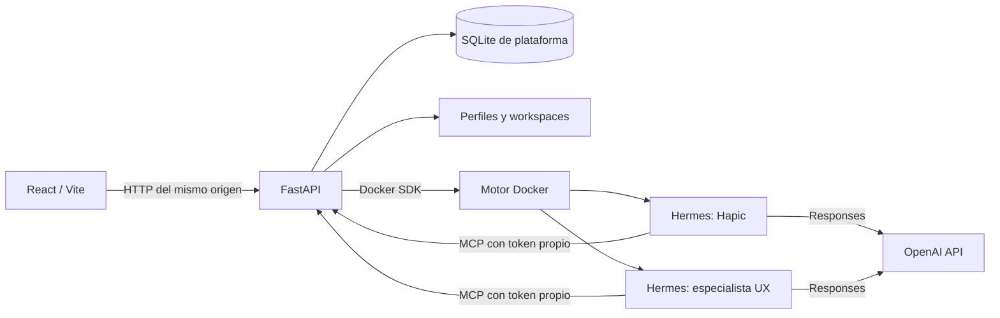

# Arquitectura

Hapic es un control de gestión local para agentes Hermes persistentes. La versión inicial separa la interfaz, los metadatos de la plataforma y los procesos de los agentes.

## Componentes

| Componente | Responsabilidad | Código |
| --- | --- | --- |
| Interfaz | Onboarding, navegación, chat, archivos y ajustes | `frontend/src/` |
| API | Sesión local, validación, rutas HTTP y servidor MCP | `backend/app.py` |
| Servicio | Organizaciones, proyectos, perfiles, permisos y herramientas | `backend/service.py` |
| Almacenamiento | SQLite, rutas persistentes, cifrado y tokens | `backend/storage.py` |
| Runtime | Configuración Hermes, contenedores, readiness y chat | `backend/runtime.py` |
| Plantillas | Comportamiento y método revisables, sin estado privado | `templates/` |
| Herramientas | Catálogo de integraciones y permisos efectivos por agente | `backend/tool_catalog.py` |
| YouTube | OAuth de Google, tokens cifrados y consultas limitadas al canal asignado | `backend/youtube.py` |

FastAPI sirve el build de Vite en producción. En desarrollo, Vite reenvía `/api` al backend. El chat actual espera una respuesta completa del servidor; la interfaz no implementa streaming de tokens.

## Modelo de datos

Una organización agrupa proyectos. Cada proyecto tiene un orquestador Hapic y especialistas UX, diseño gráfico, arquitectura/planning, código o community management. La tabla `memberships` relaciona al operador local con las organizaciones y se comprueba al acceder a proyectos o agentes. El [catálogo de herramientas](youtube.md) permite asignar YouTube de solo lectura a cualquier agente; Community Manager lo incluye inicialmente. Los canales OAuth pertenecen al proyecto y las credenciales permanecen en el servidor.

`platform.db` contiene organizaciones, pertenencias, proyectos, agentes, mensajes visibles, imágenes, actividad, ajustes y sesiones locales. `agents.planner_id` vincula un coder al arquitecto. El estado de Hermes vive en otro SQLite dentro de su propio perfil. La inicialización crea tablas e índices y añade `planner_id` a instalaciones previas sin borrar datos; no incluye un framework general de migraciones.

Los identificadores generados se usan como nombres de carpetas. Los nombres elegidos por el usuario se conservan en metadatos y no se interpretan como rutas.

## Creación y ejecución de agentes

1. Crear un proyecto materializa sus metadatos, carpetas y un perfil Hapic nuevo. Si hay una key configurada, se solicita su provisión.
2. Hapic consulta el catálogo de templates y pregunta el nombre cuando falte. La interfaz también permite crear perfiles desde un formulario.
3. La herramienta MCP `create_specialist_agent` valida el alcance del token y crea un perfil limpio; `create_ux_agent` se conserva por compatibilidad.
4. El servicio solicita la provisión en segundo plano y registra el avance. Crear el perfil o encolar el trabajo no garantiza que el contenedor esté disponible.
5. El provisionador descarga la imagen si hace falta, monta únicamente el home y el workspace del agente e inicia `gateway run`.
6. El runtime solo queda disponible cuando `/health/detailed` responde autenticado con `status: ok`.

| Estado | Significado |
| --- | --- |
| `pending` | Perfil preparado; arranque pendiente |
| `provisioning` | Provisión en curso |
| `running` | Última provisión completada con readiness comprobado |
| `blocked` | Falta un requisito o el runtime no pudo quedar listo |
| `error` | Falló la provisión y se registró un mensaje seguro |

La consulta de runtime puede devolver además `starting`, `stopped` o `unavailable` según su comprobación actual. La tabla de agentes muestra el estado registrado y el detalle consulta la API real. La disponibilidad de Hermes no verifica por sí sola el acceso al modelo de OpenAI: eso se comprueba al ejecutar un turno.

## Modelos y conversaciones

El valor inicial es `gpt-6.1-sol` con `xhigh`. Los ajustes globales se aplican a perfiles nuevos; el compositor permite cambiar el modelo y esfuerzo de un agente existente para su siguiente turno.

La configuración de Hermes fija `provider: openai-api`, `api_mode: codex_responses` y el endpoint oficial de OpenAI. El cliente del control de gestión utiliza `/v1/responses`, selección explícita de proveedor/modelo y `model_options.reasoning_effort`. No utiliza ni importa OAuth de Codex.

Cada conversación usa una identidad estable del agente. `Idempotency-Key` protege las solicitudes hacia Hermes y la plataforma registra la identidad del turno para evitar duplicar mensajes al repetir una solicitud con el mismo identificador.

## Persistencia y aislamiento

Cada agente tiene un `HERMES_HOME` montado en `/opt/data` y un workspace distinto montado en `/workspace`. Los documentos de UX se leen y escriben mediante herramientas MCP autorizadas en el workspace de ese agente.

Las carpetas organizan el estado. La autorización de la API, los tokens por agente, las herramientas permitidas y los montajes Docker controlan el acceso. Las instrucciones del modelo no sustituyen esos controles.

Las plantillas contienen `SOUL.md`, definición y habilidades. Al crear un perfil se inicializa memoria vacía; nunca se clonan `state.db`, credenciales o recuerdos privados de un agente usado.

### Planes compartidos

El arquitecto publica en `workspace/plans/<architect-id>/plan.md` del proyecto. Los coders vinculados lo leen mediante la herramienta dedicada; no se monta todo el proyecto en sus contenedores. Antes de escribir, el servidor comprueba que el coder haya leído la revisión SHA-256 actual. Cada coder conserva un workspace separado. Escriben código y pruebas, sin terminal ni ejecución automática.

### Imágenes

`backend/images.py` llama a `/v1/images/generations` con la credencial del servidor. Decodifica base64 y valida PNG y tamaño. La herramienta escribe atómicamente en el workspace antes de registrar un mensaje de archivo y una fila `images`. Ese mensaje se conserva si después falla Hermes. La UI carga los bytes desde una ruta autenticada del mismo origen y permite descargar; no guarda base64 en SQLite ni solicita URLs arbitrarias del proveedor.

Las instrucciones de integración actualizadas se envían en `instructions` de cada petición Responses, sin sobrescribir el `SOUL.md` ni memorias existentes. La lista de herramientas de un runtime existente se actualiza al recrearlo.

## Confianza y alcance

El MVP permite un operador local. La sesión no es un sistema de cuentas remoto y no ofrece aislamiento frente al administrador del equipo. El control de gestión puede administrar el motor Docker; los agentes no reciben su socket.

La key del formulario se cifra con una clave maestra local. Los procesos y contenedores que realizan inferencia necesitan la credencial en su entorno. Un administrador de Docker o del equipo puede acceder a ese entorno.

El estado se guarda localmente. Los mensajes y el contexto necesario para cada turno se transmiten a OpenAI. Consulta [operación](operations.md) para copias de seguridad, rotación y recuperación.
