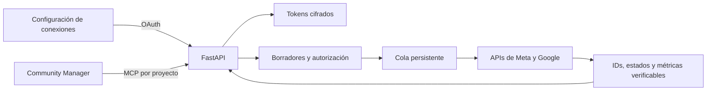

# Community Manager e integración social

Fecha de revisión: 2026-11-06. La plantilla y [YouTube de solo lectura](youtube.md) están implementados. Instagram, publicación, respuestas y programación son propuestas pendientes.

## Perfil disponible

En **Plantillas → Community Manager → Usar plantilla**, selecciona el proyecto y da nombre al agente. Hapic también puede crearlo con `create_specialist_agent` y `template: community-manager`. Cada instancia recibe perfil Hermes, memoria nueva y workspace propios. No requiere un arquitecto vinculado. Para conversar necesita Docker y la credencial de inferencia, como los otros agentes.

Su objetivo es mantener la voz de marca, planear contenido para Instagram y YouTube, preparar conversaciones y convertir datos reales en decisiones editoriales.

| Responsabilidad | Entregable |
| --- | --- |
| Marca, audiencia, objetivos, tono y restricciones | `brief-comunidad.md` |
| Pilares, formatos, llamadas a la acción e indicadores | `estrategia-contenido.md` |
| Fechas, hora, zona horaria, canal, recursos, responsables y estado | `calendario-editorial.csv` |
| Copys, carruseles, guiones de Reels, vídeos y Shorts; briefs de miniaturas | `contenidos.md` |
| Clasificación de comentarios y propuestas de respuesta | `respuestas-comunidad.md` |
| Fuente, periodo, definición de métricas, resultados e hipótesis | `reporte-metricas.md` |

Puede listar, leer y escribir archivos propios. Incluye YouTube de solo lectura: al conectar un canal en Herramientas y asignárselo, consulta vídeos, comentarios e informes reales. Cualquier agente puede recibir esta integración. Instagram sigue trabajando con datos aportados por el usuario. No tiene navegador, publicación, programación, respuestas o generación de vídeo. Los briefs visuales y las fechas del CSV siguen siendo propuestas.

## Opciones de conexión

### Instagram

La ruta propuesta es **Instagram API con Instagram Login**, para cuentas profesionales Business o Creator. Necesita una app de Meta y autorización de la cuenta. La colección oficial enumera `instagram_business_basic`, `instagram_business_content_publish`, `instagram_business_manage_comments` y, para mensajes, `instagram_business_manage_messages`. Solicitar solo las funciones habilitadas. El flujo alternativo **Facebook Login** requiere una página vinculada y utiliza permisos distintos. [Colección oficial de Meta](https://www.postman.com/meta/instagram/documentation/6yqw8pt/instagram-api).

Antes de implementarlo, validar permisos y disponibilidad de Insights, acceso para cuentas externas y revisión de la app en la versión elegida. Los mensajes deben incorporarse por separado: la conversación por API parte de un mensaje del usuario de Instagram. [Meta: API de Instagram](https://www.postman.com/meta/instagram/documentation/6yqw8pt/instagram-api).

Para Reels: crear contenedor, esperar procesamiento y publicar. Si se usa `video_url`, Meta debe poder descargar el vídeo; una ruta de `127.0.0.1` no sirve. [Meta: publicación de Reels](https://www.postman.com/meta/instagram/documentation/6yqw8pt/instagram-api).

Para Hapic se propone almacenamiento de medios con URLs temporales y una cola persistente. Guardar el contenedor y el ID final para consultar el resultado antes de reintentar; marcar éxito solo tras una respuesta verificable.

### YouTube

La configuración y las funciones de lectura actuales están documentadas en [YouTube](youtube.md). Los permisos de subida, respuesta y programación de la tabla siguiente corresponden a funciones futuras.

Crear un proyecto de Google Cloud, habilitar **YouTube Data API v3**, configurar consentimiento y cliente OAuth y autorizar el canal. Una API key permite consultas públicas; las escrituras y los datos privados requieren OAuth. Para operar después de cerrar el navegador, solicitar acceso offline y guardar el refresh token cifrado. [Google: autorización de YouTube](https://developers.google.com/youtube/data/guides/authentication).

| Función | API y permiso |
| --- | --- |
| Identificar canal y consultar datos de la cuenta | Data API, `youtube.readonly` |
| Subir vídeo con título y descripción | `videos.insert`, `youtube.upload` |
| Responder un comentario | `comments.insert`, `youtube.force-ssl` |
| Informes de rendimiento del canal | Analytics API, `yt-analytics.readonly`; validar además los permisos exigidos por la consulta elegida |

Los permisos usan el prefijo `https://www.googleapis.com/auth/`. Pedir autorización adicional cuando se active una función que la necesite. Fuentes: [subida de vídeos](https://developers.google.com/youtube/data/reference/rest/v3/videos/insert?hl=en), [respuestas](https://developers.google.com/youtube/data/reference/rest/v3/comments/insert?hl=en) y [Analytics](https://developers.google.com/youtube/analytics/reference/).

Subir primero con `status.privacyStatus=private` explícito para revisar el resultado. Para programar, `status.publishAt` exige un vídeo privado que nunca se haya publicado y una fecha válida; una fecha pasada puede publicarlo inmediatamente. [Google: estado del vídeo](https://developers.google.com/youtube/data/reference/rest/v3/videos?hl=en#status.publishAt).

Antes de ofrecerlo a terceros, comprobar la verificación OAuth aplicable. [Google: OAuth para servidores](https://developers.google.com/youtube/reporting/guides/authorization/server-side-web-apps). Controlar cuotas desde el proyecto y verificar procesamiento, audiencia y recursos antes de publicar. La plantilla actual no produce ni recibe archivos de vídeo: hace falta una entrada de medios aparte del chat de texto.

## Arquitectura propuesta para Hapic

La arquitectura completa de escritura y programación es una propuesta. OAuth de Google, conexiones por proyecto, asignaciones de YouTube por agente y las cuatro consultas de lectura ya están disponibles; consulta sus rutas y controles en [YouTube](youtube.md).

1. Añadir **Conexiones** por proyecto: proveedor, cuenta/canal verificado, permisos, caducidad y estado real. Permitir conectar, volver a autorizar y desconectar. La configuración actual de OpenAI solo sirve para inferencia.
2. Implementar OAuth en FastAPI con `state` aleatorio, de un solo uso, ligado a sesión, proveedor y proyecto; callback registrado exactamente y PKCE cuando corresponda. Confirmar identidad con el proveedor. Conservar tokens cifrados en el servidor, fuera del workspace, chat, logs y contenedores Hermes. Al desconectar, revocar cuando sea posible, borrar tokens e impedir trabajos pendientes.
3. Crear tablas de conexiones, acceso de agentes a cuentas, borradores, autorizaciones, trabajos y resultados. El token MCP seguirá determinando el proyecto. Validar también qué agente puede usar qué cuenta y permisos; no aceptar un alcance arbitrario indicado por el modelo.
4. Empezar con herramientas de lectura (`list_social_connections`, `get_social_metrics`, `list_social_comments`) y borradores (`create_social_draft`). Son nombres propuestos. Habilitar escrituras solo con comprobaciones en servidor; las instrucciones del perfil no sustituyen la autorización.
5. Mostrar una vista previa con cuenta, recurso real, texto, visibilidad y hora. Registrar la autorización del usuario sobre esa versión exacta. Cambiar cuenta, contenido o fecha invalida la autorización anterior. Ejecutar después la publicación o respuesta y devolver el ID real del proveedor.
6. Usar una cola con estados, fecha UTC, zona horaria original, idempotencia y reintentos limitados. Ante un timeout incierto, consultar el resultado antes de repetir una escritura. Registrar errores redactados y reautorizar tokens revocados. El equipo y el servidor deben estar activos para ejecutar una cola local a la hora prevista.
7. Para callbacks o webhooks de Meta que requieran HTTPS público, desplegar una entrada específica y validar firmas. Mantener privada la administración de Hapic; no exponer todo el MVP local. Para YouTube, empezar consultando comentarios periódicamente.

## Orden recomendado de implementación

| Etapa | Resultado verificable |
| --- | --- |
| Disponible ahora | Crear Community Manager y guardar estrategia, contenido y calendario como borradores |
| 1. Autorizar una cuenta de prueba | Conexión visible con identidad, permisos reales, desconexión y errores redactados |
| 2. Lectura | Informe con métricas reales, fuente y periodo; lista real de comentarios |
| 3. Escritura puntual | Publicación o respuesta autorizada, sin duplicación y con ID del proveedor |
| 4. Programación | Trabajo persistente que respete hora, reinicios, revocación y cambios de borrador |

Se recomienda empezar por el canal que ya tenga cuenta y recursos listos. Si ambos están disponibles, YouTube permite probar primero una subida privada; para una estrategia centrada en piezas gráficas y Reels, priorizar Instagram. La elección depende del objetivo de la marca.

Las consultas YouTube y OAuth se verifican con un transporte de Google exclusivo de pruebas, incluidos alcance, renovación/revocación y ausencia de secretos. Una cuenta real requiere el consentimiento del usuario; los dobles no acreditan una conexión real. Las funciones futuras de escritura necesitarán además pruebas de cambios de borrador, autorización, reintentos y publicaciones reales.
